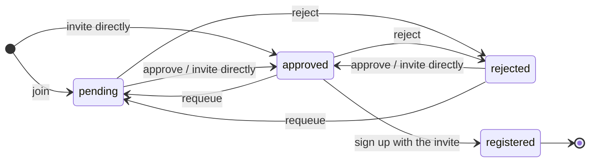

# better-auth-waitlist

[](https://www.npmjs.com/package/better-auth-waitlist)
[](./LICENSE)

A [Better Auth](https://better-auth.com) plugin that puts sign-up behind a waitlist. People join, you approve them (or invite them directly), and only invited emails can create an account. Sign-in for existing users is never affected.

- **One gate for every sign-up method**: email and password, OAuth (redirect, ID token, One Tap), magic link, email OTP, anonymous, `admin.createUser`.
- **Single-use invite codes**, bound to one email, hashed at rest, with an expiry. The code survives OAuth and magic-link redirects.
- **Status links** showing the queue position, sent by email and confirmed with a POST so mail scanners can't confirm.
- **Referrals** with share links, self-referral detection and a success callback for your rewards.
- **Manager endpoints** to list, approve (by id or "next N"), reject, requeue, boost, invite and delete, gated by the admin plugin's roles or your own check.
- **No email enumeration**: join, refusals and timing look the same whether an email is new, pending, rejected or already a user.
- **Typed, tiny client** (about 2 kB gzipped). No server code, zod or `better-call` reaches the browser.
- Adapter-agnostic, ESM only, Better Auth `^1.7.0`.

> Coming from 3.x? v4 is a rewrite: read [Upgrading from v3](#upgrading-from-v3).

## Contents

- [Install](#install)
- [Quick start](#quick-start)
- [How it works](#how-it-works)
- [Managing the waitlist](#managing-the-waitlist)
- [The sign-up gate](#the-sign-up-gate)
- [Referrals](#referrals)
- [Client API](#client-api)
- [Options](#options)
- [Production checklist](#production-checklist)
- [Upgrading from v3](#upgrading-from-v3)

## Install

```sh
pnpm add better-auth-waitlist
# or: npm install better-auth-waitlist / yarn add better-auth-waitlist / bun add better-auth-waitlist
```

`better-auth` and `@better-auth/core` (`^1.7.0`) are peer dependencies.

## Quick start

### 1. Add the plugin to your server

```ts
// auth.ts
import { betterAuth } from "better-auth"
import { admin } from "better-auth/plugins"
import { waitlist } from "better-auth-waitlist"

export const auth = betterAuth({
  // ...database, emailAndPassword, socialProviders
  plugins: [
    admin(), // admins are waitlist managers by default
    waitlist({
      statusLink: { buildUrl: (token) => `https://example.com/waitlist?token=${token}` },
      sendStatusLink: async ({ email, url }) => {
        await sendEmail(email, "You're on the waitlist", `Check your place in line: ${url}`)
      },
      invite: { buildUrl: (code) => `https://example.com/register?code=${code}` },
      sendInvite: async ({ email, url }) => {
        await sendEmail(email, "You're invited", `Create your account: ${url}`)
      },
    }),
  ],
  // Send emails after the response, so timing doesn't reveal who is on the list.
  advanced: { backgroundTasks: { handler: (promise) => waitUntil(promise) } },
})
```

### 2. Update your database

The plugin adds a `waitlistEntry` model. Generate or apply it with the [Better Auth CLI](https://www.better-auth.com/docs/concepts/cli), as for any plugin.

### 3. Add the client plugin

```ts
// auth-client.ts
import { createAuthClient } from "better-auth/client"
import { waitlistClient } from "better-auth-waitlist/client"

export const authClient = createAuthClient({ plugins: [waitlistClient()] })
```

### 4. Build three pages

**Join page.** Show the same "check your inbox" screen whatever happens, so the page never reveals whether an email is already on the list or already has an account (the email itself tells the person).

```ts
import { isWaitlistError, WAITLIST_ERROR_CODES } from "better-auth-waitlist/client"

const ref = new URLSearchParams(location.search).get("ref") ?? undefined
const { error } = await authClient.waitlist.join({ email, referralCode: ref })
if (isWaitlistError(error)) showMessage(WAITLIST_ERROR_CODES[error.code].message)
else showCheckYourInbox()
```

Only `WAITLIST_CLOSED`, `WAITLIST_FULL` and `EMAIL_NOT_ALLOWED` need their own message: they never depend on who the email belongs to.

**Status page** (the `statusLink.buildUrl` URL). Confirm the entry, then show the position and the share link.

```ts
const token = new URLSearchParams(location.search).get("token") ?? ""
await authClient.waitlist.confirm({ token }) // a POST, and idempotent
const { data, error } = await authClient.waitlist.status({ query: { token } })
if (error?.code === "INVALID_STATUS_TOKEN") showBadLink()
else if (data) {
  showPosition(data.position, data.queueLength) // position is null once approved
  showShareLink(`${location.origin}/join?ref=${data.referralCode}`, data.referralCount)
}
```

**Register page** (the `invite.buildUrl` URL). Check the code before showing the form, and lock the email field to the invited address.

```ts
import { getRedirectError } from "better-auth-waitlist/client"

const code = new URLSearchParams(location.search).get("code") ?? ""
const { data } = await authClient.waitlist.invite.accept({ code })
if (!data?.valid) showInvalidInvite()
else showSignUpForm({ email: data.email, emailLocked: true }) // any sign-up method works from here

// Back from an OAuth or magic-link sign-up that was refused:
const refused = getRedirectError(location.search) // "WAITLIST_INVITE_REQUIRED" | "INVALID_INVITE_CODE" | null
```

That's it: sign-up is now invite-only. Approve people from your admin UI with `authClient.waitlist.admin.approve(...)`, or from a job with `auth.api.approveWaitlistEntries(...)`.

## How it works

Each email on the list has one **waitlist entry**, with one of four statuses:

- **pending**: in the queue. The **position** comes from the join time (minus any boost), so it's always up to date.
- **approved**: has a live invite. Approving issues an invite code and calls `sendInvite`.
- **registered**: the invite was used to create an account. A registered entry never admits again.
- **rejected**: refused.



Joining sends a **status link** (`sendStatusLink`) to the email. Opening it confirms the inbox and shows the position. A direct invite (`admin.invite`) creates an approved entry straight away.

Deleting a user deletes their entry. To come back, they join again or are invited again.

## Managing the waitlist

The manager endpoints need a signed-in **manager**. By default that's whoever the [admin plugin](https://www.better-auth.com/docs/plugins/admin) treats as an admin: its `adminUserIds`, or a role in its `adminRoles` (default `["admin"]`).

- `admin.permission`, for example `{ waitlist: ["manage"] }`, requires an access-control statement from the admin plugin's `roles` instead.
- `admin.canManage(input)` replaces the check entirely.
- Without the admin plugin or `canManage`, nobody is a manager, and the plugin warns at startup.

The check reads the session and role from the database, not from a cookie cache, so a demoted manager loses access immediately.

```ts
// From your admin UI (manager session):
await authClient.waitlist.admin.approve({ entryIds: [id] })
await authClient.waitlist.admin.approve({ next: 20, confirmedOnly: true })
await authClient.waitlist.admin.invite({ email: "ada@example.com" })

// From server code, e.g. a nightly job: a call without headers is trusted.
await auth.api.approveWaitlistEntries({ body: { next: 20 } })
```

> **Forward the request headers when you call a manager endpoint on a user's behalf.** A server call without `headers` or `request` is trusted as your own code and skips the manager check.

### Invites

An invite is a random code (base62, 24 characters by default). The plugin stores only its SHA-256 hash, and the code expires after `invite.expiresIn` (7 days by default, `null` for never). `sendInvite` receives `{ entry, email, code, url, expiresAt, reason }`, where `reason` is `"approved"`, `"direct"`, `"resent"` or `"auto"`. Resending replaces the code, so the old one stops working. Set `invite.returnCodeToManager` to get the raw code in manager responses, for copy-and-paste invites.

## The sign-up gate

While the plugin is active, a user can only be created for an **admitted** email: one whose entry is `approved`, with a live invite and the matching code. Admission uses the invite up, so one invite creates exactly one account. The gate is a single database hook on user creation, so it covers every sign-up method, including your own `internalAdapter.createUser` calls. **Sign-in is never gated**: existing users, including ones created before you installed the plugin, keep signing in as before.

`invite.accept({ code })` sets a signed, HttpOnly invite cookie (30 minutes by default) that carries the code through OAuth and magic-link redirects. Server-side callers can send the code in the `x-waitlist-invite` header instead, and the header wins over the cookie.

How each method reports a refusal:

| Method                             | Refusal                                                                                                                           |
| ---------------------------------- | --------------------------------------------------------------------------------------------------------------------------------- |
| Email and password                 | 403 `WAITLIST_INVITE_REQUIRED` or `INVALID_INVITE_CODE`\*                                                                         |
| OAuth redirect, magic link         | Redirect to `errorCallbackURL` with `?error=WAITLIST_INVITE_REQUIRED` (or `INVALID_INVITE_CODE`). Read it with `getRedirectError` |
| OAuth ID token, One Tap, email OTP | 403 JSON with the code                                                                                                            |

\* With `requireEmailVerification` or `autoSignIn: false`, Better Auth hides the refusal behind its normal sign-up response (no user, no email). That's why the register page checks the code first.

No refusal says whether an email is pending, rejected or not on the list.

### Letting some users through

- `join.autoApprove`: approve on join, and admit at sign-up without a code. As a predicate, it gets `emailVerified`, which is only true when an identity provider vouched for the email. **A predicate that trusts a domain must check it**, because an email sign-up can type any address:

  ```ts
  waitlist({
    join: { autoApprove: ({ email, emailVerified }) => emailVerified && email.endsWith("@corp.example") },
  })
  ```

- `gate.bypass({ user, ctx })`: return `true` to let a creation through, for example staff you invite another way. The default lets `admin.createUser` through. **A bypass that matches on the email must also check `user.emailVerified`.**
- `gate.requireInviteCode: false`: admit any approved email with a live invite, without the code.

### Guests: users with no account

If your app creates user rows outside sign-up (a checkout or a booking that records the customer's email), those users have no account and can't sign in. The plugin calls them **Guests**:

- They can join the waitlist like anyone else.
- An email sign-up with the entry's invite code **claims** the existing row: it attaches a password to the same user id (so your linked data stays), marks the email verified and registers the entry. Without a valid code, Better Auth's usual `USER_ALREADY_EXISTS` refusal stays, so knowing a Guest's email isn't enough to take over the row.
- Password reset, which would otherwise give a Guest a login, is blocked until the gate would admit them.

Users with at least one account are unaffected.

## Referrals

Every entry has a public `referralCode`, returned by `status` for share links. Joining with someone's code records them as the referrer. Unknown codes and self-referrals are ignored silently.

When the referred entry reaches `referral.successOn` (by default `"confirm"`, when the referred person confirms their inbox), the plugin calls `onReferralSuccess` **once per entry**. The plugin never rewards anyone on its own. To reward, boost the referrer:

```ts
waitlist({
  onReferralSuccess: async ({ referrer, referralCount }) => {
    // One hour ahead per successful referral, for the first ten.
    if (referralCount <= 10) {
      await auth.api.boostWaitlistEntry({ body: { entryId: referrer.id, seconds: 3600 } })
    }
  },
})
```

Things to know if rewards are worth gaming:

- **Self-referral detection** compares `referral.canonicalizeEmail` forms. The default only strips a `+tag`, so `a.da@gmail.com` can still use `ada@gmail.com`'s code. Pass a stricter function if needed.
- **Once per entry, not per person.** Someone who is deleted and joins again with the same code can succeed again, so dedupe rewards on `referred.email`.
- **The callback is never retried.** The success is recorded before the call. For guaranteed delivery, write to an outbox table in the callback and process it in a job.
- Only `pending` entries can be boosted. Boosting an approved referrer returns 409.

## Client API

`waitlistClient()` adds `authClient.waitlist`, typed from the server plugin. Every client call has a server equivalent on `auth.api`.

| Client (`authClient.waitlist.*`) | Server (`auth.api.*`)    | Who                          |
| -------------------------------- | ------------------------ | ---------------------------- |
| `join`                           | `joinWaitlist`           | Anyone                       |
| `status`                         | `getWaitlistStatus`      | Anyone with the status token |
| `confirm`                        | `confirmWaitlistEntry`   | Anyone with the status token |
| `invite.accept`                  | `acceptWaitlistInvite`   | Anyone with the invite code  |
| `admin.list`                     | `listWaitlistEntries`    | Managers                     |
| `admin.stats`                    | `getWaitlistStats`       | Managers                     |
| `admin.approve`                  | `approveWaitlistEntries` | Managers                     |
| `admin.reject`                   | `rejectWaitlistEntries`  | Managers                     |
| `admin.requeue`                  | `requeueWaitlistEntry`   | Managers                     |
| `admin.resendInvite`             | `resendWaitlistInvite`   | Managers                     |
| `admin.invite`                   | `inviteToWaitlist`       | Managers                     |
| `admin.boost`                    | `boostWaitlistEntry`     | Managers                     |
| `admin.delete`                   | `deleteWaitlistEntry`    | Managers                     |

`better-auth-waitlist/client` also exports:

- `getRedirectError(search)`: reads a refused OAuth or magic-link sign-up from `location.search`, a URL or `URLSearchParams`, including with hash routers.
- `isWaitlistError(error)`: narrows an error to a waitlist error code.
- `WAITLIST_ERROR_CODES`: every code with its message. Use it to show messages: Better Auth's `authClient.$ERROR_CODES` has the codes in its type but no runtime value.
- The `WaitlistEntry` and `WaitlistStatus` types. `better-auth-waitlist/types` has every public type and no runtime code.

Error codes: `WAITLIST_INVITE_REQUIRED`, `INVALID_INVITE_CODE`, `WAITLIST_CLOSED`, `WAITLIST_FULL`, `EMAIL_NOT_ALLOWED`, `INVALID_STATUS_TOKEN`, `INVALID_STATUS_TRANSITION`, `ENTRY_NOT_FOUND`, `NOT_ALLOWED_TO_MANAGE_WAITLIST`.

### Extra fields on join

To collect more on join (a company name, say), add fields to the schema and give the client the **same** definition. Nothing checks that the two agree, so share one object:

```ts
// waitlist-fields.ts, imported by both the server and the client config
export const waitlistSchema = {
  waitlistEntry: { additionalFields: { company: { type: "string", required: false } } },
} as const

waitlist({ schema: waitlistSchema }) // auth.ts
waitlistClient({ schema: waitlistSchema }) // auth-client.ts
```

## Options

All options are optional.

| Option                       | Default                        | Description                                                                                                           |
| ---------------------------- | ------------------------------ | --------------------------------------------------------------------------------------------------------------------- |
| `gate.enabled`               | `true`                         | Block sign-up for emails the waitlist doesn't admit.                                                                  |
| `gate.requireInviteCode`     | `true`                         | Require the invite code at sign-up, not only an approved entry.                                                       |
| `gate.bypass`                | lets `admin.createUser` in     | `({ user, ctx }) => boolean`: let a creation through without admission.                                               |
| `gate.allowWithoutContext`   | `false`                        | Send creations with no request context (your own `internalAdapter` calls) to `bypass` instead of refusing them.       |
| `gate.joinOnBlockedSignUp`   | `false`                        | Put refused emails on the waitlist and send their status link.                                                        |
| `join.enabled`               | `true`                         | Accept new entries.                                                                                                   |
| `join.maxEntries`            | none                           | Cap on pending entries (`WAITLIST_FULL` beyond it).                                                                   |
| `join.allowedDomains`        | all                            | Email domains allowed to join (case-insensitive).                                                                     |
| `join.validate`              | none                           | `({ email, name, emailVerified, request }) => boolean`: refuse with `EMAIL_NOT_ALLOWED`.                              |
| `join.autoApprove`           | `false`                        | `true`, or a predicate: approve on join and admit at sign-up without a code.                                          |
| `statusLink.buildUrl`        | required with `sendStatusLink` | `(token) => string`: your status page URL.                                                                            |
| `statusLink.resendAfter`     | `600`                          | Seconds before the same entry can be sent its status link again.                                                      |
| `invite.buildUrl`            | required with `sendInvite`     | `(code) => string`: your register page URL.                                                                           |
| `invite.expiresIn`           | `604800` (7 days)              | Invite lifetime in seconds, or `null` for never.                                                                      |
| `invite.codeLength`          | `24`                           | Length of the base62 code.                                                                                            |
| `invite.returnCodeToManager` | `false`                        | Return raw codes in manager responses.                                                                                |
| `invite.cookieMaxAge`        | `1800`                         | Invite cookie lifetime in seconds.                                                                                    |
| `invite.header`              | `"x-waitlist-invite"`          | Header that can carry the code.                                                                                       |
| `referral.enabled`           | `true`                         | Accept referral codes and record successes.                                                                           |
| `referral.successOn`         | `"confirm"`                    | `"confirm"` or `"register"`: when a referral counts.                                                                  |
| `referral.canonicalizeEmail` | strips `+tag`                  | Normalizes emails to detect self-referrals.                                                                           |
| `admin.permission`           | none                           | Access-control statement a manager's role must grant.                                                                 |
| `admin.canManage`            | admin plugin roles             | Replaces the manager check.                                                                                           |
| `rateLimit`                  | per endpoint                   | `{ [endpoint]: { window, max } }`, or `false`. Defaults: join 5/min, status 30/min, confirm and invite accept 10/min. |
| `schema.waitlistEntry`       |                                | `modelName` and `fields` to rename the table and columns, `additionalFields` to add columns.                          |

Callbacks:

| Callback             | Called with                                      | When                                                      |
| -------------------- | ------------------------------------------------ | --------------------------------------------------------- |
| `sendStatusLink`     | `{ entry, email, token, url, reason }`           | Someone joins, rejoins, or is put on the list by the gate |
| `sendInvite`         | `{ entry, email, code, url, expiresAt, reason }` | An invite is issued or resent                             |
| `onExistingUserJoin` | `{ user }`                                       | Someone who already has an account joins                  |
| `onJoin`             | `{ entry, referrer, source }`                    | An entry is created                                       |
| `onStatusChange`     | `{ entry, from, to, event, actorUserId }`        | An entry changes status                                   |
| `onReferralSuccess`  | `{ referrer, referred, referralCount }`          | A referred entry reaches `referral.successOn`             |

Callback errors are logged with codes, tokens and passwords redacted, and never fail the request. Predicates (`gate.bypass`, `join.validate`, `join.autoApprove`, `admin.canManage`, `referral.canonicalizeEmail`) treat a throw as "no".

## Production checklist

- **Set `advanced.backgroundTasks.handler`** (for example `waitUntil` on Cloudflare Workers or Vercel) if you send emails from the callbacks or use `gate.joinOnBlockedSignUp`. Without it, a join that sends mail is slower than one that doesn't, which reveals who is on the list, and serverless runtimes may drop the background work. The plugin warns at startup.
- **Use a database that enforces unique indexes.** Duplicate joins are rejected by the unique index on `email`. Better Auth's memory adapter doesn't enforce it (the plugin warns).
- **Prefer an adapter with transactions.** Inside a transaction (email sign-up and OAuth on most adapters), the invite is claimed atomically. Without one (magic link, email OTP, or drizzle's default `transaction: false`), single-use relies on the code being bound to one email and on the unique index on `user.email`.
- **Make sure someone can manage the list**: install the admin plugin, or set `admin.canManage`.

## Upgrading from v3

v4 is a rewrite. It needs `better-auth` and `@better-auth/core` `^1.7.0`, is ESM only, and ships three entry points: `better-auth-waitlist` (server), `better-auth-waitlist/client` and `better-auth-waitlist/types`.

There is **no automatic data migration**. v4 stores entries in a new `waitlistEntry` model, with the statuses `pending`, `approved`, `rejected` and `registered`. Generate the new schema with the Better Auth CLI, re-add the entries you want to keep (through `auth.api` join or manager calls), then drop the v3 `waitlist` table.

| v3                                     | v4                                                                                             |
| -------------------------------------- | ---------------------------------------------------------------------------------------------- |
| `enabled`                              | `join.enabled` (accepting entries) and `gate.enabled` (blocking sign-up)                       |
| `allowedDomains`                       | `join.allowedDomains`                                                                          |
| `maximumWaitlistParticipants`          | `join.maxEntries`                                                                              |
| `autoApprove`                          | `join.autoApprove`                                                                             |
| `validateEntry`                        | `join.validate`                                                                                |
| `additionalFields`, `schema`           | `schema.waitlistEntry.additionalFields` (give the client the same fields)                      |
| `disableSignInAndSignUp`               | Removed: the gate only blocks sign-up for emails the waitlist doesn't admit, and never sign-in |
| `canManageWaitlist(user)`              | `admin.canManage(input)` or `admin.permission` (defaults to the admin plugin's roles)          |
| `onJoinRequest`                        | `onJoin`                                                                                       |
| `onStatusChange`                       | `onStatusChange` (new payload: `from`, `to`, `event`, `actorUserId`)                           |
| `notifications`                        | `sendStatusLink` and `sendInvite` (you send the emails)                                        |
| `rateLimit: { maxAttempts, windowMs }` | `rateLimit`, per endpoint: `{ window, max }`, or `false`                                       |

The v3 source stays on the [`v3` branch](https://github.com/slargat/better-auth-waitlist/tree/v3) and is no longer maintained.

## Contributing

See [`CONTRIBUTING.md`](./CONTRIBUTING.md).

## License

[MIT](./LICENSE)
